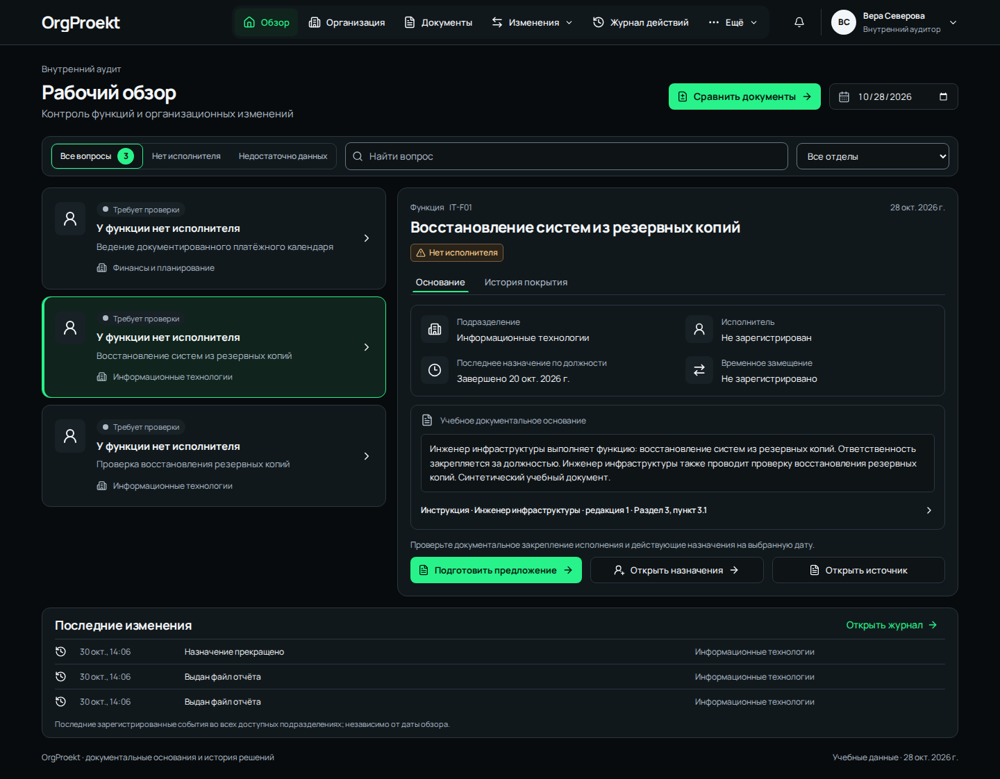
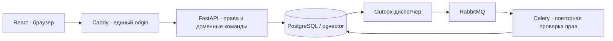

# OrgProekt

> **Для удобства знакомства с проектом новая локальная учебная установка запускается без обязательной MFA (двухфакторной аутентификации). Автоматическое резервное копирование по умолчанию выключено: расписание не устанавливается, копии можно создавать вручную или включить расписание по желанию.** Вход — по личному логину и паролю, права отделов и журнал действий сохраняются. Используйте только вымышленные данные и локальный адрес `orgproekt.localhost`.
>
> Это отдельный учебный режим `LOCAL_DEMO_MODE=true`. Без этого параметра MFA обязательна. Существующие `.env`, пользователи, настроенные факторы и ранее установленное расписание резервного копирования автоматически не изменяются. [Режимы запуска и переключение](docs/LOCAL_DEMO.md).

Рабочее пространство документального анализа организационной структуры, функций и кадровых изменений.

Проект предназначен для специалистов и команд компаний, которым нужно анализировать документы, сравнивать редакции и оформлять предложения изменений. Он разворачивается самостоятельно через Docker по инструкции из репозитория. Место установки и правила сетевого доступа выбирает владелец развёртывания.

**Автор: Синельников Иван Евгеньевич.** Учебный портфолио-проект со значительным применением AI-assisted разработки. Авторский код распространяется по [лицензии MIT](LICENSE); сторонние материалы сохраняют свои лицензии, перечисленные в [уведомлениях](docs/THIRD_PARTY_NOTICES.md). Организация, сотрудники и основания вымышлены. По умолчанию шапка показывает OrgProekt; отображаемое название меняется через существующую настройку организации. Исторические документы сохраняются. Это не внедрение в реальную компанию и не система автоматических кадровых решений.

**English:** OrgProekt is a document-grounded workspace for organizational change analysis, with scoped access, effective-dated appointments, an audit trail and a human-reviewed AI roadmap.

Для первого знакомства начните с [установки на Windows](docs/SETUP_WINDOWS.md), затем пройдите [учебный пример от двух документов до PDF/DOCX](docs/DEMO_WALKTHROUGH.md). Все сведения в примере вымышлены. Ключ Gemini для него не требуется.

Основные таблицы PostgreSQL и связи между ними собраны в [схеме базы данных](docs/DB_SCHEMA.md).



## Текущая версия

В отдельной учебной HTTPS-копии можно подключить Windows Hello через **Моё пространство → Безопасность входа → Ключи доступа**. После подключения на странице входа доступна кнопка **Войти по ключу доступа**. [Инструкция для Windows](docs/SETUP_WINDOWS.md).

**Ограничение технических логов.** Docker автоматически хранит до трёх файлов по 10 МБ на контейнер со сжатием старых файлов. Настройка применена к работающим службам, данные/права сохранены и проверены. [Проверка и границы](docs/OPERATIONS_WINDOWS.md).

**Чистая установка и нагрузка.** Установка из опубликованного коммита проверена на отдельной базе: вход, документы, границы отдела и CSRF работают. Результаты ступенчатой проверки чтения на этом ПК и ограничения выводов — в [отчёте о нагрузке](docs/LOAD_TEST_WINDOWS.md).

**Защита входа и ресурсов.** Сервер завершает сеанс после 30 минут бездействия (абсолютный срок — 8 часов); фоновое обновление страницы его не продлевает. При активном вводе длинной формы браузер раз в минуту подтверждает сеанс, а за пять минут до его завершения показывает предупреждение. Несохранённый текст автоматически в хранилище браузера не записывается: перед общим восьмичасовым пределом сохраните черновик. Вход ограничен по аккаунту и общему числу попыток, одновременное вычисление хешей паролей ограничено. Службы Compose получили лимиты памяти; при их превышении операция может завершиться ошибкой, которую нужно расследовать. Учебный режим без MFA по-прежнему предназначен только для локального знакомства с вымышленными данными.

**Резервное копирование и восстановление.** `scripts/backup.ps1` создаёт согласованный зашифрованный снимок БД с документами/отчётами и необходимыми секретами, внешний age-ключ хранится отдельно. Расписание Windows включается отдельно; на компьютере автора оно создаёт локальную копию ежедневно в 03:00 при работающем Docker Desktop и хранит три последние автоматические копии отдельно от ручных. `restore-lab.ps1` восстанавливает только в новый изолированный стенд на 8082 и проверяет данные/права/аудит/файлы. Контрольное восстановление 09.11.2026 подтвердило 915 строк в 52 таблицах, права, аудит и файлы после миграции сеансов. Основной 8080 продолжает работать. [Инструкция Windows](docs/BACKUP_RESTORE_WINDOWS.md). Внешнее хранение новых архивов и остальные эксплуатационные задачи этапа 4 ещё требуют работы.

**Новое: «Доступ» для `access`.** Личные приглашения с самостоятельным выбором пароля и MFA, запросы назначения роли с отделом/сроком/основанием, независимое подтверждение руководителем, отзыв прав, блокировка и завершение сессий. Администратор не получает бизнес-данные и не выдаёт права себе. Под `demo_manager` очередь открывается через «Ещё → Доступ». На локальном стенде код приглашения передаётся вручную; почтовой отправки нет. Сценарий проверки: [docs/ACCESS_WORKFLOW.md](docs/ACCESS_WORKFLOW.md). Существующие аккаунты, MFA, роли и отчёты сохранены.

**Новое: «Изменения» → «Отчёты».** Подготовка заключения или выписки из предложения → сохранённые редакции → проверка reviewer → неизменяемый выпуск → PDF/DOCX. Исправление создаёт связанный выпуск, прежние файлы сохраняются; текущий реестр исполнения отображается отдельно. Пошаговая инструкция и учебный рецензент — [docs/REPORT_WORKFLOW.md](docs/REPORT_WORKFLOW.md). Полная эксплуатационная часть этапа 4 ещё не завершена.

Реализованы **этапы 0–1, документы/сравнение/поиск этапа 2 и процесс предложений этапа 3 и отчёты этапа 4**. Интерфейс обновлен по согласованному макету 29.10.2026: черный фон, графитовые поверхности, зеленые действия, верхнее меню и компактный рабочий обзор. Слева — реальные вопросы покрытия с поиском и фильтрами, справа — выбранная функция, документальное основание и история. Организация открывается таблицей подразделений и сотрудников; React Flow остается дополнительным режимом «Схема». Сохранены вход с TOTP/recovery, кадровые события, источники, уведомления и права. Вход — единая центрированная форма.

Расширенный учебный набор: **26 сотрудников в 5 подразделениях**, 20 должностей, 24 штатные единицы и 21 документированная функция. На 28.10.2026 в исходном расширенном наборе у 23 сотрудников есть действующее назначение. Завершённые назначения, временное замещение, вакансия и несколько исполнителей одной функции доступны для проверки на разных датах. Кадровые команды пользователя могут изменить эти показатели.

В этапе 2 работают загрузка DOCX/PDF, оригиналы и редакции, локальное извлечение и точные источники; зафиксированные комплекты «до/после», сравнение с историей рассмотрения аудитором и гибридный поиск PostgreSQL FTS + pgvector. Эмбеддинги вычисляются локально на CPU, Gemini не вызывается. Адаптер Gemini подготовлен; реального вызова ещё не было. LangGraph и анализ неоднозначностей через LLM остаются следующими частями. Отчёты готовятся и проверяются человеком, без Gemini. Состояние проверок: [docs/PROGRESS.md](docs/PROGRESS.md). Production запрещён конфигурацией до завершения необходимых мер развёртывания. Текущий запуск — только loopback и синтетические данные.

**«Изменения» → «Предложения»** открывает процесс этапа 3: версионная таблица «до/после», источники и последствия, адресное обсуждение и согласование, закрытые заметки автора, управленческое решение, планирование, учёт исполнения и проверка аудитора. Утверждение само по себе не меняет реестр. Новая версия требует повторного направления; история сохраняется. Подробный порядок и границы — [docs/CHANGE_WORKFLOW.md](docs/CHANGE_WORKFLOW.md). Для учебного руководителя/рецензента предусмотрена отдельная команда `workflow-demo`, которая добавляет новые аккаунты и не изменяет прежние права.

Для сравнения нажмите **«Сравнить документы»** в обзоре или **«Изменения» → «Комплекты и сравнение» → «Комплекты»**: создайте два набора точных редакций с датой и заявлением полноты. В **«Сравнения»** выберите их и укажите критерии. После обработки доступны категории, текстовые изменения, цитаты и история рассмотрения. Решение аудитора не изменяет официальный реестр функций. Изменение состава документов требует нового комплекта и запуска.

**«Ещё» → «Поиск по содержанию»** объединяет слова и смысл; доступны отдельные режимы, отдел, комплект, редакция и дата начала действия. Результаты ограничены текущими правами. При недоступности модели гибридный режим явно переходит на поиск по словам. Пустая выдача не означает отсутствия функции. Меню пользователя открывает «Моё пространство», обновление данных и выход. На узком экране все разделы доступны через кнопку меню.

Модель `intfloat/multilingual-e5-small` (MIT, закреплённая редакция и SHA-256) загружается **при сборке образа**, около 129 МиБ. После сборки внешняя сеть для поиска/сравнения не требуется. Успешно обработанные загрузки индексируются автоматически. Для старых ручных выдержек доступна кнопка «Подготовить поиск» или локальная команда оператора (добавляет только производный индекс и аудит):

```powershell
./scripts/docker.ps1 compose --profile tools run --rm tools python -m app.search_maintenance
```

На проверенном CPU первый запуск модели с двумя фразами занял около 1 секунды, пиковый RSS — около 477 МиБ на процесс. Это не замер нагрузки всего стека: API и каждый занятый процесс worker имеют собственную копию модели. Параметры, лимиты и порядок смены модели — [docs/AI_PIPELINE.md](docs/AI_PIPELINE.md).

## Быстрый запуск — Windows PowerShell

Потребуются Windows 11, работающий Docker Desktop с WSL 2 и Git. Скачайте репозиторий и откройте PowerShell в его папке, где находится `compose.yml`. Команды ниже предназначены для первого запуска с пустой базой. При первой сборке нужен интернет для загрузки образов, зависимостей и модели поиска.

```powershell
./scripts/setup.ps1
./scripts/docker.ps1 compose up -d --build --wait
./scripts/docker.ps1 compose --profile tools run --rm tools python -m app.cli seed
./scripts/docker.ps1 compose --profile tools run --rm tools python -m app.cli expand-demo
./scripts/docker.ps1 compose --profile tools run --rm tools python -m app.cli workflow-demo
```

Откройте [http://orgproekt.localhost:8080](http://orgproekt.localhost:8080). Старый адрес `http://localhost:8080` перенаправляет сюда и удаляет старый cookie сеанса. Нужно войти заново; аккаунты, права, документы и история сохраняются. Отдельное имя защищает cookie OrgProekt от обычных служб на других портах `localhost`; не запускайте посторонние службы под именем `orgproekt.localhost`. Миграции выполняются перед стартом API. Seed запускается **один раз на пустой базе**; при существующих данных команда безопасно откажет. Для уже заполненного стенда выполняйте только `expand-demo`: команда добавляет 20 вымышленных сотрудников и связанные основания, не переписывает существующие записи, историю, аккаунты или MFA. Повторный запуск не создаёт дублей. Reset базы и удаление volumes для обновления не нужны.

Уникальные пароли аккаунтов `auditor`, `hr`, `it`, `finance`, `access` находятся в **`.local/demo-accounts.json`**. Команда `workflow-demo` создаёт `demo_manager` и `demo_reviewer` и сохраняет их пароли в **`.local/workflow-accounts.json`**. Откройте файлы локально в редакторе. В новой учебной установке достаточно пароля. Если выбран режим с MFA, при первом входе добавьте TOTP в приложение-аутентификатор и сохраните восемь резервных кодов. Эти файлы, пароли и коды хранятся только у владельца установки. `access` открывает управление доступом.

Если PowerShell запрещает запуск сценариев, выполните `Set-ExecutionPolicy -Scope Process -ExecutionPolicy RemoteSigned` в этом окне и повторите команду. Для повторного запуска готового стенда достаточно `./scripts/docker.ps1 compose up -d --wait`.

Если обычная команда `docker` уже работает, её можно использовать вместо `./scripts/docker.ps1`. Обёртка нужна для терминала со старым PATH и не меняет системные настройки.

```powershell
./scripts/docker.ps1 compose ps
Invoke-RestMethod http://orgproekt.localhost:8080/api/health
./scripts/docker.ps1 compose stop
./scripts/docker.ps1 compose up -d
```

Ожидается `{"status":"ok"}`. Stop/restart/rebuild сохраняют данные в volumes. `down --volumes` удаляет постоянные данные — для основной базы эту команду не используйте.

## Демонстрация первого сценария

1. Войти как `auditor`, открыть «Организация», раскрыть состав ИТ, найти сотрудника и открыть его карточку/основание. Для визуального просмотра переключиться на «Схема»; основной режим остаётся табличным.
2. В другом браузерном профиле войти как `hr`. Выбрать IT-01 → «Прекратить назначение». Ввести первый день без назначения, номер/дату документа, точный пункт и выдержку.
3. У аудитора появится уведомление. Две документированные ИТ-функции получат статус «Нет исполнителя» с нужной даты.
4. HR оформляет назначение Тимура Ясного с более поздней даты. Для временного назначения указать дату окончания; она не входит в период.
5. Открыть «Периоды покрытия» и «Кадровые события»: разрыв закрыт, прежняя история и основание сохранены.
6. Войти как `finance`: ИТ отсутствует в разрешённой структуре; прямые запросы чужих UUID возвращают 404. В E2E это проверяется через API, а не только скрытием кнопок.

Для тестового прогона используются даты 20–25 октября 2026 года. Это тестовые данные, а не реальные события.

## Стек и структура

FastAPI/Python 3.13 · SQLAlchemy/Alembic · PostgreSQL 17/pgvector · Celery/RabbitMQ · React 19/TypeScript · Zustand · Tailwind 4 · shadcn/ui · React Flow · Motion · Magic UI Shimmer Button · Caddy/Compose.



`backend/` — приложение, миграции и интеграционные тесты; `frontend/` — интерфейс, Vitest и Playwright; `infra/` — Caddy/DB; `scripts/` — локальные команды; `docs/` — решения, инструкции, прогресс и снимки. Точные Python/npm зависимости закреплены lock-файлами, контейнеры — digest. Node/Python на хост устанавливать не нужно.

## Контракт API и сохранение данных

Реальные модели запросов/ответов FastAPI экспортируются в `frontend/openapi.json`; `tools/contracts/generate.mjs` генерирует `frontend/src/lib/schema.generated.ts`. Все сетевые операции frontend используют `openapi-fetch` через `frontend/src/lib/client.ts`; `lib/api.ts` содержит только форматирование дат. Генератор изолирован в `tools/contracts` с TypeScript 5.9.3 для совместимости `openapi-typescript`, тогда как приложение собирается TypeScript 7. У обоих наборов отдельные lock-файлы. Экспорт и генерация поддерживают `--check` для обнаружения устаревшего контракта.

Маршруты, параметры, авторизация, ошибки и повторы описаны в [docs/API.md](docs/API.md). Перегенерация контрактов из корня проекта, без установки Python/Node на Windows и без передачи реальных секретов:

```powershell
$repositoryPath = (Get-Location).Path
$contractNodeImage = 'node:24-bookworm-slim@sha256:55fb5f5a527ea2c5c4a95f963e48ef90aa38c7b346054fdc8ee9957a2b55d205'
./scripts/docker.ps1 run --rm -v "${repositoryPath}:/repo" -w /repo/backend orgproekt-backend:local python scripts/export_openapi.py --output ../frontend/openapi.json
./scripts/docker.ps1 run --rm -v "${repositoryPath}:/repo" -w /repo $contractNodeImage sh -c 'npm ci --prefix tools/contracts && node tools/contracts/generate.mjs'
```

Для проверки без перезаписи добавьте `--check` к командам `export_openapi.py` и `generate.mjs`. Перед экспортом после изменения Python-зависимостей пересоберите backend-образ через `./scripts/docker.ps1 compose build api`.

Сервер проверяет сессии, выбранную политику MFA, CSRF, роли и область отдела независимо от видимости элементов интерфейса. Списки возвращают `items`, `total`, `offset`, `limit`; ошибки — код, сообщение, ошибки полей и correlation ID. Клиент ограничивает время запроса, отменяет устаревшие чтения, показывает ошибку и повтор. Кадровые команды сохраняют ключ идемпотентности при повторной отправке того же запроса; конфликт версии не выдаётся за успех. Название организации хранится в БД с `expected_version`; его изменение не переписывает документы и историю.

Caddy сохраняет единый origin. Текущий HTTP разрешён только для loopback-разработки с учебными данными; production HTTPS/TLS и защищённое развёртывание этой доработкой не объявляются готовыми. Секреты остаются серверными, Gemini key в браузер не передаётся.

Перед добавлением данных к существующей базе можно зафиксировать и затем проверить сохранность прежних строк. Команды используют основную БД только в транзакции **READ ONLY**; новые строки разрешены, изменение или исчезновение прежнего PK даёт ненулевой код выхода:

```powershell
$preservationScripts = Join-Path (Get-Location).Path 'backend/scripts'
./scripts/docker.ps1 compose -p orgproekt -f compose.yml --profile tools run --rm --no-deps --pull never -v "${preservationScripts}:/checks:ro" tools python /checks/preservation_check.py snapshot --path /private/pre-update.json
# После аддитивного обновления:
./scripts/docker.ps1 compose -p orgproekt -f compose.yml --profile tools run --rm --no-deps --pull never -v "${preservationScripts}:/checks:ro" tools python /checks/preservation_check.py verify --path /private/pre-update.json
```

Снимок содержит PK, SHA-256 и метаданные схемы без содержимого строк; существующий файл не перезаписывается. Он сохраняется в `.local/pre-update.json`, игнорируемом Git. Проверяются 11 бизнес-таблиц, включая прежние документы/события/аудит; данные входа и изменяемые фоновые таблицы исключены. Это контроль сохранности при добавлении записей, а не резервная копия для восстановления.

## Проверки

Состав файлов перед публикацией проверяется командой `node scripts/check-publication.mjs` при установленном Node.js 20 или новее. Она учитывает также принудительно добавленные в Git файлы. Порядок проверки содержимого через Gitleaks и результаты чистого запуска приведены в [проверке публикации](docs/PUBLICATION_CHECK.md).

```powershell
./scripts/docker.ps1 compose -f compose.yml -f compose.test.yml --profile tests run --rm tests
./scripts/e2e.ps1
./scripts/docker.ps1 compose --profile tools run --rm tools python -m app.cli verify-audit
```

Первая команда создаёт и удаляет только временную PostgreSQL-базу `orgproekt_test_*`. E2E пересоздаёт **только отдельный проект `orgproekt-e2e`**, завершает его после прогона и сохраняет снимки в `docs/screenshots/`. CI повторяет установку по lock, lint, сборку, тесты, Gitleaks и аудиты зависимостей; реальный Gemini key не нужен. GitHub CI не считается проверенным до первого запуска на GitHub.

## Gemini — позже, самостоятельно

Откройте локальный `.env` в редакторе и добавьте `GEMINI_API_KEY` и `GEMINI_MODEL`. Не используйте `VITE_` и не вводите ключ в frontend. Оставьте `GEMINI_ENABLED=false`. Адаптер и отдельная проверочная команда готовы. **Само добавление ключа не включает ИИ и не выполняет запрос.**

После изменения окружения пересоздайте процессы:

```powershell
./scripts/docker.ps1 compose up -d --force-recreate api worker scheduler
```

Текущая версия показывает только наличие настройки без значения секрета. Перед первым настоящим запросом проверьте выбранную модель в [Free Tier pricing](https://ai.google.dev/gemini-api/docs/pricing), реальные [квоты проекта](https://ai.google.dev/gemini-api/docs/rate-limits) и условия обработки данных в AI Studio. Конфигурация не подтверждает бесплатность аккаунта; автоматического выбора модели или платного fallback нет.

После этой проверки можно явно разрешить **только отдельному процессу** до двух запросов с фиксированной вымышленной фразой (при 429/5xx один повтор). Основные процессы и `.env` остаются выключенными:

```powershell
./scripts/docker.ps1 compose --profile tools run --rm --no-deps -e GEMINI_ENABLED=true tools python -m app.gemini_smoke --confirm-synthetic-free-tier
```

Успех означает, что SDK получил валидную схему и проверяемые цитаты. Это не приёмка будущего полного ИИ-процесса. Команда не читает документы из БД, не выводит ключ и не запускается автоматически.

## Загрузка документов

Откройте «Документы» → «Загрузить документ», выберите разрешённый отдел, DOCX/PDF до 10 МиБ и метаданные. Для безопасной проверки доступны [синтетический DOCX](frontend/e2e/fixtures/synthetic-regulation.docx), [PDF с текстом](frontend/e2e/fixtures/synthetic-regulation.pdf), [PDF без текста](frontend/e2e/fixtures/synthetic-scan.pdf). Они содержат только вымышленные сведения.

Оригинал сохраняется сразу, обработка выполняется очередью. Карточка показывает техническое состояние, предупреждения, поиск и точные фрагменты, скачивание проверенного оригинала и историю редакций. Новая редакция не переписывает старую. Неизвестная дата остаётся неизвестной; загрузка не означает утверждение и не меняет кадровые назначения. По умолчанию внешняя обработка запрещена. Сканы требуют OCR, которого в этом срезе нет. Подробные ограничения — [AI_PIPELINE.md](docs/AI_PIPELINE.md).

## Документация

* [Настройка Windows](docs/SETUP_WINDOWS.md), [Ubuntu](docs/DEPLOY_UBUNTU.md), [перенос данных](docs/MIGRATION_WINDOWS_TO_UBUNTU.md).
* [Спецификация](docs/PROJECT_SPEC.md), [план](docs/IMPLEMENTATION_PLAN.md), [решения](docs/ADR.md), [доменные даты](docs/DOMAIN_MODEL.md), [контракт API](docs/API.md).
* [Дизайн и четыре UI-библиотеки](docs/DESIGN_SYSTEM.md), [права](docs/ACCESS_MATRIX.md), [модель угроз](docs/THREAT_MODEL.md).
* [Прогресс](docs/PROGRESS.md), [проверки и трассировка](docs/EVALUATION.md), [стандарты](docs/STANDARDS_MAPPING.md), [план ИИ](docs/AI_PIPELINE.md), [сторонние материалы](docs/THIRD_PARTY_NOTICES.md).

Перед отправкой в GitHub проверьте секреты, документы и сторонние лицензии. Реальные кадровые документы не помещайте в fixtures или Git, даже под именем «обезличено».

