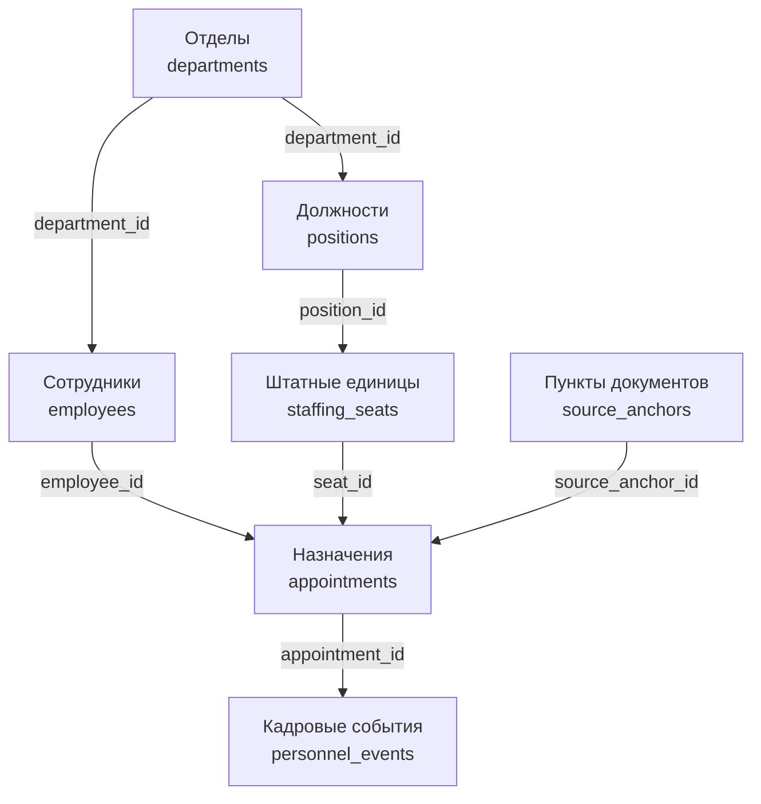
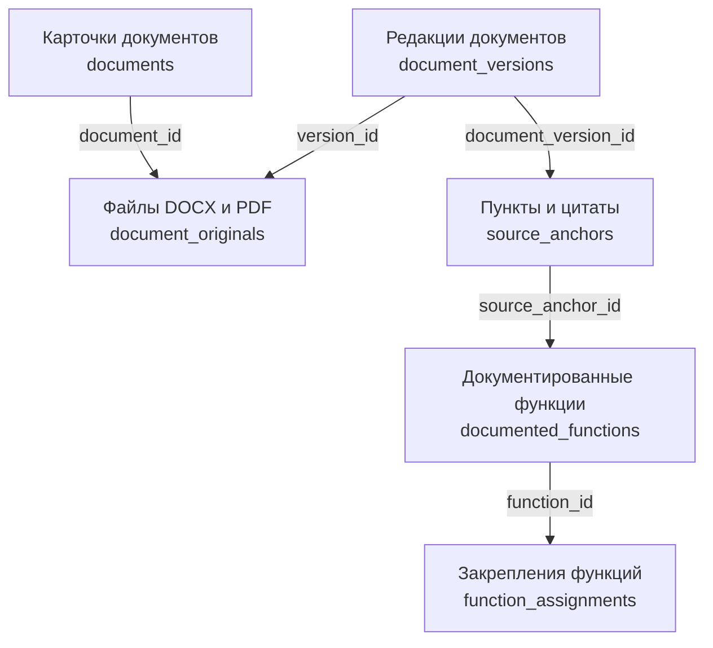
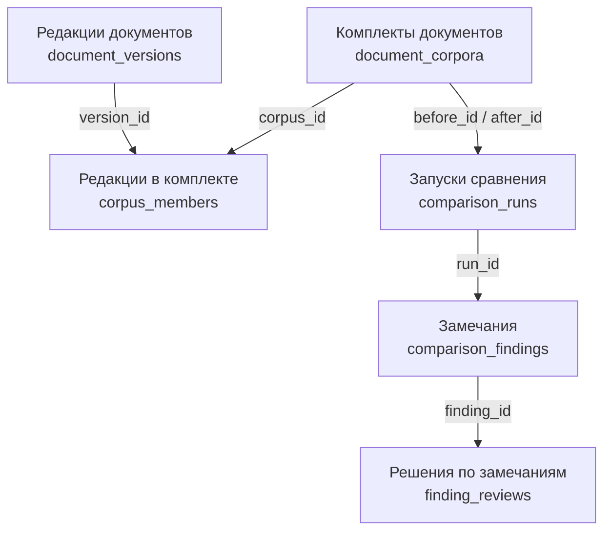
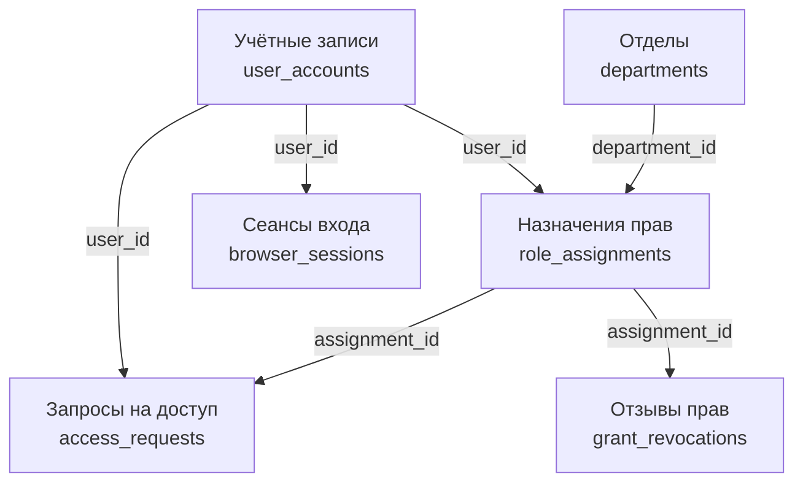
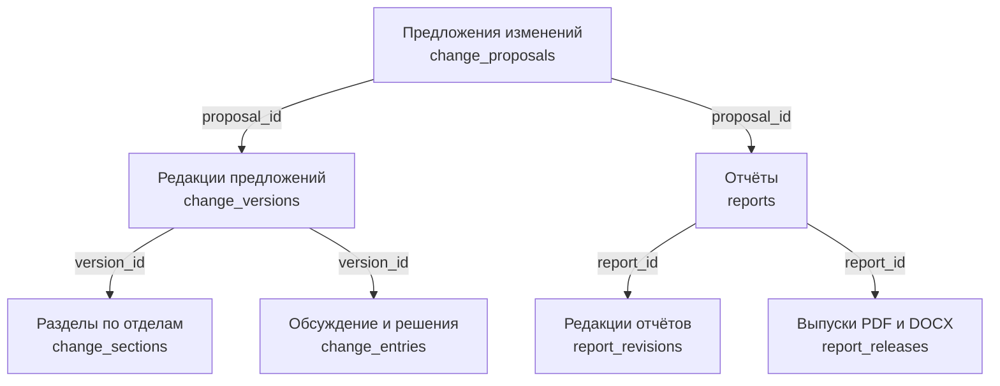

# Схема базы данных OrgProekt

OrgProekt хранит данные в PostgreSQL. На схемах ниже показаны основные таблицы. Стрелка ведёт к таблице, в которой находится внешний ключ. Подпись на стрелке показывает его поле.

## Сотрудники и назначения

Назначение фиксирует, кто занимает конкретную штатную единицу, на какой срок и на основании какого пункта документа. PostgreSQL запрещает пересекающиеся периоды назначений на одну единицу. Кадровые события хранят историю регистрации, прекращения и исправления назначений.

## Документы и функции

`document_originals` хранит файл и связывает карточку документа с конкретной редакцией. `source_anchors` хранит точное место и цитату из редакции. Документированная функция ссылается на этот источник. Закрепление функции указывает подразделение и может ссылаться на конкретную должность.

## Комплекты и сравнение

Каждый запуск сравнения фиксирует два комплекта «до» и «после». Результаты и решения аудитора по ним сохраняются отдельными записями. Для поиска по смыслу таблица `search_chunks` связывает фрагменты цитат с векторами pgvector.

## Учётные записи и доступ

Назначение права хранит роль, период действия и отдел, если право ограничено отделом. После одобрения запроса в нём сохраняется ссылка на выданное право. Отзыв создаёт отдельную запись и сохраняет историю назначения.

## Предложения и отчёты

Предложение сохраняет редакции и привязанные к ним обсуждения и решения. Редакция отчёта содержит снимок предложения и источников. В записи выпуска хранятся номер выпущенной редакции, файлы PDF и DOCX и их контрольные суммы.

## Журнал действий и исходники

`audit_events` хранит события аудита с временем, типом действия и идентификаторами участника и объекта, когда они доступны. База также хранит задания обработки, уведомления и записи, по которым сервер распознаёт повторные команды.

Определения таблиц можно найти в `models.py` и файлах `*_models.py` в [каталоге приложения](../backend/app), а историю изменений структуры — в [миграциях Alembic](../backend/migrations/versions). Правила работы с датами, правами и версиями описаны в [доменной модели](DOMAIN_MODEL.md).
